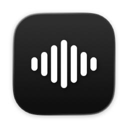
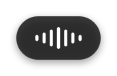

<p align="center">
  
</p>

<h1 align="center">just transcribe</h1>

<p align="center"><strong>Press a key. Talk. It's typed.</strong></p>

<p align="center">
  <a href="https://github.com/n-kasatkin/just-transcribe/releases/latest/download/just-transcribe.dmg"><strong>Download just-transcribe.dmg</strong></a><br>
  macOS 14+, Apple Silicon · tested on macOS 26
</p>

<p align="center">
  
</p>

## How it works

1. You press your hotkey. A small pill appears and records.
2. You talk, then press the hotkey again. Escape cancels.
3. The text is pasted where your cursor is. It also stays on the clipboard.

## Why it's light

- The download is 10.0 MB. The installed app is 19.5 MiB; 15.1 MiB of that (78%) is the bundled ostt helper.
- At idle the app uses 14 MB of memory (physical footprint), 0.0% CPU and 3 threads.
- Between dictations nothing runs but the menu-bar app. ostt starts for a take, or when Settings asks it something, and exits after.
- No Electron, Python, ffmpeg or Homebrew.
- No account, subscription or telemetry.
- Models are optional downloads. With a cloud provider you download none.

Every number comes from [docs/measurements.md](docs/measurements.md), with the commands that produced it.

## Setup

On first launch a setup window walks you through four things.

1. **Microphone.** The app records your voice while you dictate.
2. **Accessibility.** The app pastes the text where your cursor is. Without it, the text is only copied.
3. **A hotkey.** There is no default; you pick one.
4. **An engine.** Paste an API key for a cloud provider (OpenAI, Deepgram, DeepInfra, Groq, AssemblyAI, Berget, ElevenLabs or Mistral), or download an offline model.

You can reopen this window from the menu-bar icon: **Setup…**. Start at login is a toggle in Settings.

## Offline models

ostt runs Whisper and Parakeet models on your Mac, with no network after the download. Open **Settings → Offline models**, pick a model, download it and press **Use**.

For speech that mixes languages, use **Whisper Large v3 Turbo Q5_0**; the list marks it Recommended. Models are stored in `~/.local/share/ostt/models`. You remove them from the same tab.

## Keywords

Add names, product terms and jargon in **Settings → Keywords**. ostt passes them to your provider, so they come back spelled the way you want. Replacements and other advanced options live in `ostt.toml`; **Open ostt.toml** on the same tab opens it.

## Privacy

- Your API keys sit in ostt's `credentials` file, mode 0600, in `~/.local/share/ostt`. Not in the Keychain.
- Your audio goes only to the provider you chose. With an offline model it never leaves your Mac.
- ostt keeps the newest 10 recordings, the transcript history with no automatic deletion, and 7 days of logs in `~/.local/share/ostt`.
- The model list comes from GitHub when you open Offline models. Models download from Hugging Face.
- The app itself sends nothing anywhere else. Its source has no networking code. Its only URLs are links it opens in your browser: the releases page (**Check for Updates…**) and the project pages in the About window.

- Each transcript stays on your clipboard after pasting, so a clipboard manager may keep it in its own history.
- The app is not sandboxed: it runs the bundled ostt with your ostt config and data folders, and it sends ⌘V to paste. It uses the hardened runtime and asks for one entitlement, the microphone.

A firewall such as Little Snitch shows these connections from the bundled `ostt` helper, not from the app.

## Built on ostt

just transcribe is a native macOS front end for [ostt](https://github.com/kristoferlund/ostt) — Open Speech-to-Text by Kristofer Lund, MIT-licensed. ostt does the transcription: cloud providers, keywords, offline Whisper and Parakeet models. just transcribe adds the hotkey, the recording pill, pasting and a settings window. Each release bundles the official, unmodified ostt release for Apple Silicon at a pinned version, and the app shares ostt's config, so the ostt CLI and the app use the same keys, keywords and models. Independent project, not affiliated with ostt's author.

### Acknowledgements

- [ostt](https://github.com/kristoferlund/ostt) by Kristofer Lund, MIT.
- [transcribe.cpp](https://github.com/handy-computer/transcribe.cpp) and [ggml](https://github.com/ggml-org/ggml), MIT.
- [KeyboardShortcuts](https://github.com/sindresorhus/KeyboardShortcuts) by Sindre Sorhus, MIT.
- [Whisper](https://github.com/openai/whisper) models by OpenAI, MIT.
- [Parakeet](https://huggingface.co/nvidia/parakeet-tdt-0.6b-v3) models by NVIDIA, CC-BY-4.0.

Full licence texts for every bundled component: [THIRD_PARTY_NOTICES.md](THIRD_PARTY_NOTICES.md).

## Build from source

You need Xcode 26 or later and [XcodeGen](https://github.com/yonaskolb/XcodeGen) 2.46 or later (`brew install xcodegen`). The first `scripts/bootstrap.sh` run needs network access to GitHub to download ostt.

```sh
scripts/bootstrap.sh
xcodebuild -scheme JustTranscribe -configuration Debug build
```

`scripts/bootstrap.sh` downloads the pinned ostt release, checks its SHA-256 and generates `JustTranscribe.xcodeproj`. You can open that project in Xcode instead of running `xcodebuild`.

Debug builds sign with an Apple Development certificate of the project's team. Without access to that team, pass your own:

```sh
xcodebuild -scheme JustTranscribe -configuration Debug build DEVELOPMENT_TEAM=<your team id>
```

Or build with no account at all ("Sign to Run Locally"):

```sh
xcodebuild -scheme JustTranscribe -configuration Debug build CODE_SIGN_IDENTITY=- DEVELOPMENT_TEAM=
```

In Xcode, set the team or "Sign to Run Locally" under **Signing & Capabilities**. `scripts/bootstrap.sh` regenerates the project from `project.yml`, so edit `project.yml` if you want the change to stay.

Tests:

```sh
cd Packages/JustTranscribeKit && swift test
```

## License

MIT. Copyright (c) 2026 Nikita Kasatkin. See [LICENSE](LICENSE).
